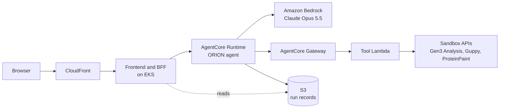

# ORION quickstart

ORION is an assistant inside the synthetic myeloma Virtual Lab. You ask a question in plain
language, and ORION shows its plan before it touches any data. It then runs the site's own tools:
cohort counts, survival comparison, mutation frequency and differential expression. The answer
shows what the tools returned, with every number cited, then an interpretation that is checked
before it is shown, and links into the site's apps. ORION asks before it saves anything.

All data is synthetic. Patient records and measurements are fabricated and have no clinical
meaning.

## How it runs



On AWS, the frontend's BFF (`/api/orion`) calls the agent in AgentCore Runtime. The agent plans
and writes with Claude Opus 5.5 on Amazon Bedrock. Every data call goes through AgentCore Gateway
to a Lambda that calls the sandbox's APIs, and every run is recorded in S3.

Locally, the same agent runs as a container in Docker Compose, next to the sandbox stack.

## Run it locally (no AWS)

You need:

- Docker Desktop, running, with Compose 2.17 or later, 12 GiB of memory and 30 GiB of free disk;
- Git, Python 3.9 or later, and Bash;
- this repository. [README.md](README.md), "Run locally", describes the sandbox stack itself.

From the repository root:

```sh
orion/scripts/orion-quickstart.sh
```

The launcher starts the sandbox stack (`scripts/start.sh`) if it is not up yet. It then starts
ORION (`orion/scripts/orion-local.sh up`), waits until the Assistant answers, and prints its URL.
The first run builds every image and takes a while.

Open <http://localhost:3080/?app=Assistant>.

The planner and composer are stubs by default, so nothing calls AWS or a model. The stubs answer
only the Assistant's built-in starter questions; for any other question, use the real models
(next section).

| To | Run |
| --- | --- |
| See the agent's health and models | `orion/scripts/orion-local.sh status` |
| Follow the agent's logs | `orion/scripts/orion-local.sh logs -f` |
| Turn ORION off (the sandbox keeps running) | `orion/scripts/orion-local.sh down` |
| Stop the whole stack | `docker compose down` |

## With the real models

The planner and composer can run on Claude Opus 5.5 on Amazon Bedrock (inference profile
`us.anthropic.claude-opus-5-5`, region `us-east-1`). The agent still runs locally; only the two
model roles change.

You need the AWS CLI and a signed-in AWS profile with Bedrock access to Claude Opus 5.5 in
us-east-1 (and to Claude Opus 5, which takes over when Opus 5.5 declines a request).

```sh
orion/scripts/orion-quickstart.sh --bedrock                  # stack, ORION, then Bedrock
orion/scripts/orion-local.sh up --bedrock                    # ORION already up: switch the agent
orion/scripts/orion-local.sh up --bedrock --profile NAME     # a profile other than `sandbox`
orion/scripts/orion-local.sh up --stub                       # back to the stubs
```

`up --bedrock` reads the credentials of the AWS profile `sandbox` (or `--profile NAME`, or
`ORION_AWS_PROFILE`). It checks them with one STS call and prints only the role name, never the
credentials. Then it rebuilds and recreates only the agent container; the frontend keeps
running. `status` then reads `planner: bedrock, composer: bedrock`. Bedrock calls cost money.

## Hosted on AWS

On AWS, ORION runs next to the hosted sandbox ([docs/aws-deployment.md](docs/aws-deployment.md)).
The Terraform module `orion/infra/terraform/orion-infra` creates the AgentCore Runtime that runs
the agent image, the AgentCore Gateway and its tool Lambda, an S3 bucket for run records and the
IAM roles; the frontend pod gets its role through EKS Pod Identity. The sandbox patch
`orion/infra/patches/sandbox.patch` pins the frontend to the ORION fork and adds ORION to the
sandbox's Helm chart, off by default. A second Helm values file, from the module's output, turns
it on in the sandbox's EKS release. The deploy steps are in
[orion/infra/README.md](orion/infra/README.md) ("Deploy order"), and the teardown is in
[orion/notes/mode-a-teardown.md](orion/notes/mode-a-teardown.md).

## Using it

Open the Assistant from **Assistant** in the top navigation, or from the **ORION Assistant** card
under Analysis Tools on the main page.

- **Ask.** Type a question in plain language in the composer. Its scope chip shows the cohort a
  question uses when it names none: the active cohort.
- **Threads.** Each conversation is a thread. **New thread** starts one, and the thread list
  switches between them. A thread's **Delete** removes it after you confirm (not while a run is in
  progress). Threads are kept in the browser tab.
- **The plan.** Before any data call, the plan card shows the scope, one row per step with the
  tool it uses, and the assumptions ORION made. Rows tick off with their results as the steps run.
  **Edit settings** changes the scope, the number of genes, the DE method or its thresholds.
  **Apply** makes a new plan version, which reuses the finished steps whose inputs did not change.
- **Stop.** While a run works, Send becomes **Stop** (Esc in the composer does the same).
  Finished steps keep their results, and the run reads "Stopped by you".
- **Saving cohorts.** A plan that saves cohorts pauses at "Waiting for you" on a card that lists
  each cohort, its definition and its case count. Nothing is saved until you click **Create**.
  **Rename** changes a name first. **Don't save** goes on with unsaved groups.
- **The answer** has four parts:
  - **Observed**: what the tools returned, written by code from templates;
  - **Interpretation**: what it might mean, written by the model and checked by code, so that
    every number in it comes from the run;
  - **Hypotheses and next steps**: follow-up chips and links into the site's apps;
  - **Limitations**: what the data or the run could not cover.
- **Fact chips.** Every number has a chip that names its plan row and step. Click it to open the
  Evidence Inspector: the step, the tool call with its request and output, and **Export the run
  record as JSON**.
- **Follow-ups and links.** A follow-up chip asks its question as a new turn in the thread. An
  **Open** link names one of the site's apps and opens it on the run's cohort in the same tab;
  Back returns to the thread. Charts in the thread are the site's own viewers, each with **Open
  with this cohort**.
- **Limits.** A question outside ORION's tools gets a "not supported" card that names the nearest
  app. ORION gives no clinical or treatment advice.

## Check it works

Run these with ORION up locally. The browser end to end needs `npm ci` and
`npx playwright install chromium` once. The evals need `docker build -t orion-agent:dev orion/agent`
once.

| Command | What it covers |
| --- | --- |
| `node orion/scripts/e2e-mode-l.mjs` | The real Assistant in headless Chromium, with the stubs: survival, mutated-genes and differential-expression runs, the save card, Stop, edits, follow-ups, a reload, unsupported questions, navigation and deleting threads. It checks the screen, the BFF routes and the run records, and saves screenshots in `orion/notes/screenshots/e2e/` |
| `ORION_E2E_MODEL=bedrock node orion/scripts/e2e-mode-l.mjs` | The same against the agent on Bedrock (after `up --bedrock`), plus Stop while planning and while writing. It checks that the model's text passed the checks and cites the run's facts. About 6 minutes of model calls |
| `orion/scripts/evals-mode-l.sh agent` | The evals E1–E24 against the local agent. Counts, p-values and gene lists are compared with an independent oracle that queries the stack itself. Reports go to `orion/evals/reports/` |
| `orion/scripts/evals-bedrock.sh run` | Switches the agent to Bedrock and runs every eval 5 times, with timings and token usage. About 45 minutes and 250 model calls |

## More detail

- [orion/agent/README.md](orion/agent/README.md): the agent, how a run executes, its settings
  and tests.
- [orion/infra/README.md](orion/infra/README.md): the local and AWS modes, the Terraform module,
  IAM and the deploy order.
- [orion/contracts/README.md](orion/contracts/README.md) and
  [orion/contracts/TOOLS.md](orion/contracts/TOOLS.md): the contract between the frontend and the
  agent, and the tool catalog.
- [orion/evals/README.md](orion/evals/README.md): the eval harness and its oracle.
- [orion/notes/mode-l-status.md](orion/notes/mode-l-status.md),
  [orion/notes/bedrock-status.md](orion/notes/bedrock-status.md) and
  [orion/notes/mode-a-status.md](orion/notes/mode-a-status.md): what is verified locally, on
  Bedrock and on AWS, and the known limits.
- [orion/notes/mode-a-teardown.md](orion/notes/mode-a-teardown.md): removing the AWS deployment.
- The frontend: [kaizzzed/mmrf-data-commons](https://github.com/kaizzzed/mmrf-data-commons)
  (`src/features/orion` and `src/pages/api/orion`).
